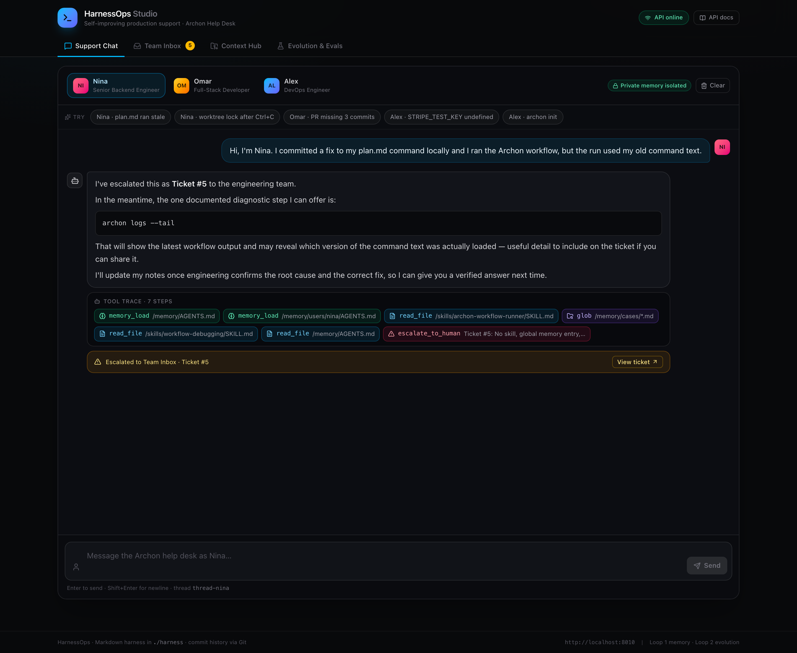
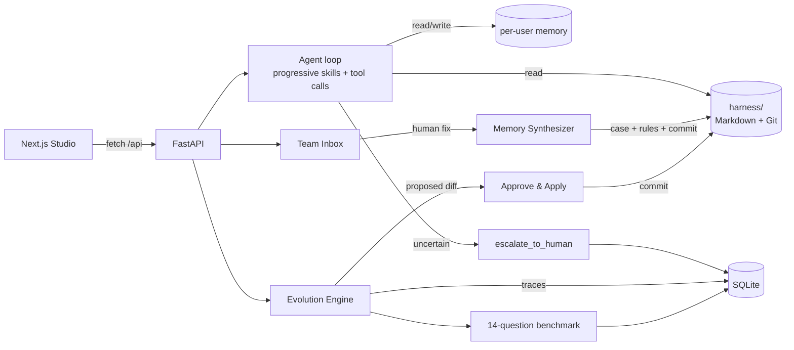

# HarnessOps

**An eval-driven support agent whose instructions, skills, and memory live in a Git-versioned Markdown harness.**

It escalates when it cannot verify an answer, turns human fixes into reusable memory, proposes its own harness changes as reviewable diffs, and proves whether any of it worked with a benchmark pinned to a commit SHA.

> **Result:** 3/14 (21.4%) → 6/14 (42.9%) → 13/14 (92.9%) → 14/14 (100%) across four harness versions, with zero escalations in the last two runs. Details and caveats below.



---

## Why this exists

Support agents fail quietly on undocumented edge cases. The usual fixes — a longer prompt, more few-shot examples, a vector database — are hard to review and easy to regress.

HarnessOps treats the prompt, skills, and memory as **runtime state under version control**:

- Uncertainty is a first-class outcome: the agent escalates instead of guessing.
- Human corrections become **case files, global rules, and private user notes** — committed atomically.
- A second loop reads failure traces and proposes a **Markdown diff** for a human to approve.
- Every eval run records the harness commit it tested, so improvements and regressions are attributable.

The product surface is a dark-mode Studio with four tabs: Chat, Team Inbox, Context Hub, and Evolution & Evals.

---

## Results

| Run | Harness commit | Passed | Accuracy | Escalations |
|---|---|---|---|---|
| v0 baseline | `65bb791` | 3/14 | 21.4% | 10 |
| after Loop 1 | `44cfd2f` | 6/14 | 42.9% | 6 |
| after Loop 2 | `6135360` | 13/14 | 92.9% | 0 |
| after final-answer fix | `f1a1925` | **14/14** | **100%** | **0** |

| Category | v0 | v1 | v2 | v3 |
|---|---|---|---|---|
| v0-baseline | 3/4 | 4/4 | 4/4 | 4/4 |
| worktree-origin-main | 0/4 | 2/4 | 3/4 | 4/4 |
| env-isolation | 0/2 | 0/2 | 2/2 | 2/2 |
| monorepo-cwd | 0/2 | 0/2 | 2/2 | 2/2 |
| pr-draft-lock | 0/2 | 0/2 | 2/2 | 2/2 |


**What the loops actually did**

1. **Loop 1** resolved Nina's escalation into `/memory/cases/case-005-archon-worktree-origin-main.md`, a global rule in `/memory/AGENTS.md`, and a private note in `/memory/users/nina/AGENTS.md` — one commit (`44cfd2f`). Omar's and Alex's related worktree questions then passed without escalation. Nina's own question still got a terse recap.
2. **Loop 2** analyzed the latest eight traces and proposed a 23-line diff to `skills/archon-workflow-runner/SKILL.md` covering worktree origin, `.archon/.env` isolation, `--workspace-root`, and `archon worktree prune --force`. Approved and applied as `6135360`; the six remaining questions across env isolation, monorepos, and lock recovery all passed.
3. **The final fix came from the eval, not from a feature request.** At v2, Q5 still failed because the agent called `update_user_memory` and ended the turn with “I've noted this in your profile…” — the substantive answer was dropped. The same bug caused Q1 to fail at v0. A new rule in `INSTRUCTIONS.md` (`f1a1925`) requires the final message to restate the complete answer after any tool call. v3: 14/14.

### Honest caveats

- **This is a 14-question scenario benchmark, not a general capability claim.** It is the same set the project was built against and there is no held-out split yet. The Loop 2 prompt names the failure areas, so 100% is an upper bound.
- **The 14/14 is one run per state.** Temperature is 0, but provider variance exists; multiple seeds and a held-out set are the next credibility step.
- The judge is strict: it requires the specific mechanism and command, not a plausible summary. It graded Q5 correctly at v2.

---

## Architecture



- **Harness:** `INSTRUCTIONS.md`, `skills/*/SKILL.md`, `memory/AGENTS.md`, `memory/cases/*`, `memory/users/{user}/AGENTS.md` in its own Git repo.
- **Agent:** LangChain tool loop (`deepseek-chat` via the OpenAI-compatible endpoint) with four tools: `glob_files`, `read_file`, `update_user_memory`, `escalate_to_human`. Skills are progressively disclosed: only YAML frontmatter is injected, full `SKILL.md` files are read on demand.
- **Backend:** FastAPI + SQLModel/SQLite for tickets, chat records, proposals, and eval runs.
- **Frontend:** Next.js App Router, Tailwind, `lucide-react`, plain `useState` + `fetch`.

### Privacy guardrail

`_check_permission` is deny-by-default. The agent can read/write only `/memory/users/{user}/**`, read shared skills/cases/`AGENTS.md`, and cannot write `INSTRUCTIONS.md` or skills.

Two issues were found and fixed while writing tests:

- `..` segments could satisfy another user's allow rule (`/memory/users/nina/../omar/AGENTS.md`). Paths are now normalized with `posixpath.normpath` before matching, and glob patterns containing `..` are rejected.
- Unmatched reads defaulted to allow. The fallback is now deny.

See `backend/tests/test_core.py`.

---

## Quickstart

```bash
# Backend (Python 3.11 recommended)
cd backend
python3.11 -m venv .venv
.venv/bin/pip install -r requirements.txt
cp .env.example .env          # set DEEPSEEK_API_KEY
.venv/bin/uvicorn app.main:app --port 8010

# Frontend (new terminal)
cd frontend
npm install
npm run dev -- --port 3001
```

Open http://localhost:3001. The API defaults to `http://localhost:8000`; this repo's `.env.local` points at `8010` because port 8000 is used by another local service. Change it if your setup differs.

Or start both:

```bash
./scripts/dev.sh
```

---

## Reproducing the benchmark

The harness ships at baseline with four seeded tickets. Nina's question becomes Ticket #5.

```bash
# 0. Snapshot before experimenting
./scripts/backup.sh

# 1. v0 baseline (harness already at v0-baseline)
curl -s -X POST http://localhost:8010/api/evals/run \
  -o benchmark/results/v0.json

# 2. Loop 1: resolve Ticket #5 with the verified fix
curl -s -X POST http://localhost:8010/api/inbox/5/resolve \
  -H 'Content-Type: application/json' \
  -d '{"human_fix":"Archon creates its execution worktrees from origin/main, not local unpushed commits. Run `git push`, then re-run `archon workflow run`."}'

curl -s -X POST http://localhost:8010/api/evals/run \
  -o benchmark/results/v1.json

# 3. Loop 2: analyze traces, apply the proposal
curl -s -X POST http://localhost:8010/api/evolution/analyze
curl -s -X POST http://localhost:8010/api/evolution/apply/1

curl -s -X POST http://localhost:8010/api/evals/run \
  -o benchmark/results/v2.json

# 4. v3: copy rule 4 from benchmark/final-harness/INSTRUCTIONS.md into
#    harness/INSTRUCTIONS.md, then commit and re-run
(cd backend && .venv/bin/python -c \
  "from app.git_hub import commit_changes; print(commit_changes('Loop 2.1: Require complete final answers after tool calls'))")

curl -s -X POST http://localhost:8010/api/evals/run \
  -o benchmark/results/v3.json

# 5. Scoreboard
python scripts/summarize_eval.py
```

Each run takes ~80–140 seconds (14 agent calls + 14 grader calls). Results are stored in SQLite with the harness SHA and exported to `benchmark/results/`.

---

## Demo

A 3-minute script is in [`docs/DEMO.md`](docs/DEMO.md). The short version:

1. Ask Nina's `plan.md` question → watch the agent read skills, find no case, and escalate as Ticket #5.
2. Open Team Inbox → paste the verified fix → “Confirm Fix & Teach Agent” → case + memory + commit.
3. Ask Omar's related question → the agent extrapolates without escalating.
4. Evolution & Evals → “Analyze Failure Traces” → review the Markdown diff → “Approve & Apply.”
5. Show the scoreboard: 21.4% → 42.9% → 92.9% → 100%, and explain that the last jump came from a bug the eval caught.

To reset to the clean demo state:

```bash
./scripts/demo-reset.sh
```

---

## Design decisions

**Why a Markdown harness instead of code?**
Behavior changes are the product surface for an agent. Keeping them in Markdown makes diffs reviewable by non-engineers and puts the same Git primitives behind prompt changes that code already has: blame, revert, audit.

**Why Git as the memory store?**
Every lesson is a commit. Rollback is one `git reset`, and every eval run can name the exact harness state it measured. A database of embeddings would lose that audit trail.

**Why not `deepagents`?**
`deepagents` is in `requirements.txt` and informed the design, but the runtime uses an explicit LangChain tool loop. The installed SDK's filesystem/permission API moved between versions, and an explicit loop made the per-user guardrail and tool trace inspectable and testable. This is a deliberate deviation from the original spec.

**Why no vector database?**
At this scale (8 harness files, a handful of cases) injecting memory and progressively disclosing skills is cheaper and more predictable than retrieval. At thousands of cases, the next step is hybrid retrieval over case symptoms — not a wholesale rewrite.

**Why SQLite + a local Git repo?**
Single-node simplicity for a demo. Production would separate Postgres for tickets/evals and object storage or a Git host for the harness, with one writer per harness.

**Why DeepSeek?**
Low cost per benchmark run (pennies), OpenAI-compatible API, and a deliberate test of provider portability. `app/llm.py` falls back to OpenAI if `DEEPSEEK_API_KEY` is absent.

---

## Limitations & next

- Add a 40-question set with a 20% held-out split; report holdout accuracy separately.
- Run each state multiple times and report variance, not a single score.
- Stream responses; current chat calls take 15–30 s.
- Add auth and per-IP rate limits before exposing the demo publicly.
- Measure cost and p95 latency per conversation.
- Multi-provider eval table (DeepSeek vs GPT-4o-mini vs Claude) on the same harness.

---

## Repository layout

```
backend/
  app/            FastAPI, agent loop, Loop 1/2 engines, Git wrapper
  tests/          guardrail, dataset, and diff tests
  eval_dataset.json
frontend/         Next.js Studio (4 tabs)
harness/          runtime Markdown harness + its own Git repo (gitignored)
benchmark/
  results/        raw EvalRun JSON per state
  final-harness/  snapshot of the 14/14 harness
  results.md
scripts/          dev, backup, restore, demo reset, eval summary
docs/             demo script, interview notes, resume bullets, screenshots
```

The `harness/` directory is runtime state with its own Git history, so it is ignored by the outer repo. The baseline is seeded from `git_hub.py`; the final evolved state is preserved in `benchmark/final-harness/` and in tags `v0-baseline`, `v1-loop1`, `v2-l2-applied`, and `v3-answer-fix`.

---

## Further reading

- [Demo script](docs/DEMO.md)
- [Interview notes](docs/INTERVIEW.md)
- [Resume bullets](docs/RESUME.md)
- [Benchmark results](benchmark/results.md)
