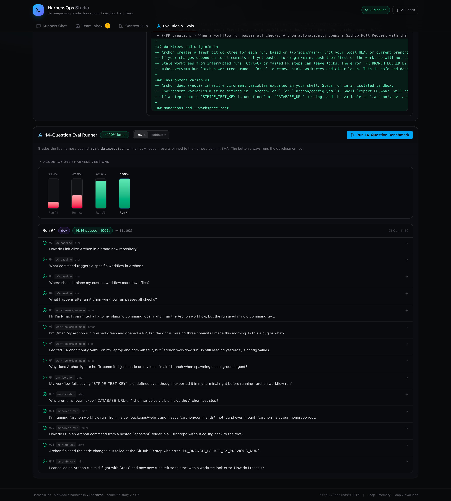

# Benchmark Results

The same 14 questions, the same model (`deepseek-chat`, temperature 0), the same LLM judge, run against four harness commits. Raw `EvalRun` JSON is in `results/`; screenshots are in `../docs/screenshots/`.

## Scoreboard

| Run | Harness commit | Passed | Accuracy | Escalations |
|---|---|---|---|---|
| v0 baseline | `65bb791` | 3/14 | 21.4% | 10 |
| after Loop 1 | `44cfd2f` | 6/14 | 42.9% | 6 |
| after Loop 2 | `6135360` | 13/14 | 92.9% | 0 |
| after final-answer fix | `f1a1925` | **14/14** | **100%** | **0** |

## Per-category (passed / total)

| Category | v0 | v1 | v2 | v3 |
|---|---|---|---|---|
| v0-baseline | 3/4 | 4/4 | 4/4 | 4/4 |
| worktree-origin-main | 0/4 | 2/4 | 3/4 | 4/4 |
| env-isolation | 0/2 | 0/2 | 2/2 | 2/2 |
| monorepo-cwd | 0/2 | 0/2 | 2/2 | 2/2 |
| pr-draft-lock | 0/2 | 0/2 | 2/2 | 2/2 |

## Held-out set

Ten questions written after the harness was frozen, never shown to Loop 2, and never used for tuning.

| Harness | Commit | Holdout | Escalations |
|---|---|---|---|
| v0 baseline | `65bb791` | 2/10 (20%) | 8 |
| final | `f1a1925` | **10/10 (100%)** | **0** |

The holdout asks the same documented behaviors with different wording and scenarios
(a teammate's hotfix, an amended commit, a missing `NPM_TOKEN`, a CI-killed run).
It measures whether the harness generalizes beyond the exact development questions.

**Caveat:** ten questions in the same knowledge domain is a smoke test, not a
statistical generalization claim. The next step is 40+ questions across new
categories and multiple runs per state.

## What changed between runs

**v0 → v1 (Loop 1).** Ticket #5 was resolved with:
> Archon creates its execution worktrees from origin/main, not local unpushed commits. Run `git push` so the commit is on the remote, then re-run `archon workflow run`.

The synthesizer wrote:
- `/memory/cases/case-005-archon-worktree-origin-main.md`
- a global rule in `/memory/AGENTS.md`
- a private note in `/memory/users/nina/AGENTS.md`
- commit `44cfd2f`

Q6 (Omar's missing commits) and Q7 (Alex's stale `.archon/config.yaml`) then passed without an escalation. Q5 and Q8 still failed.

**v1 → v2 (Loop 2).** The evolution engine read the latest eight traces and proposed a 23-line diff to `skills/archon-workflow-runner/SKILL.md` covering:
- worktrees based on `origin/main`
- `.archon/.env` isolation (shell exports are not inherited)
- `--workspace-root` in monorepos
- `archon worktree prune --force` for stale locks

Approved as proposal #1 and committed as `6135360`. All six remaining questions passed, but Q5 still failed — for a different reason.

**v2 → v3 (final-answer fix).** At v2, Q5 returned only:

> "I've noted this in your profile so I can remind you to push up front next time."

The agent composed the answer, called `update_user_memory`, and ended the turn with an acknowledgement. `run_support_agent` returns only the final assistant message, so the answer was dropped. The same failure caused Q1 at v0.

The fix is a harness rule, committed as `f1a1925`:

> **Always Finish With the Answer:** The user only sees your final message. If you call a tool (including `update_user_memory`) after composing an answer, restate the complete answer in your final message. Never end a turn with only an acknowledgement.

v3 Q5 answer:

> Archon doesn't execute workflows from your local working tree. For each run it creates a fresh git worktree based on **origin/main**… `git push` then `archon workflow run <your-workflow-name>`.

14/14, zero escalations.

## Caveats

- **The development set is small**, and the Loop 2 prompt names the failure areas. The holdout is separate and stronger evidence, but ten same-domain paraphrases are still a smoke test, not a generalization guarantee.
- **LLM judge.** Strict, but not infallible. Rationales are stored for audit.
- **One run per state.** Temperature is 0 but provider variance exists; multiple seeds would tighten confidence.
- **Memory writes during eval.** The agent can update user memory mid-run; those writes were reverted before each state to keep comparisons clean.
- **Two harness changes between measurements.** v3 differs from v2 only by the final-answer rule; the diff is in `final-harness/INSTRUCTIONS.md`.

## Files

| File | Description |
|---|---|
| `results/v0-*.json` | baseline run, harness `65bb791` |
| `results/v1-*.json` | after Loop 1, harness `44cfd2f` |
| `results/v2-*.json` | after Loop 2, harness `6135360` |
| `results/v3-*.json` | after final-answer fix, harness `f1a1925` |
| `results/holdout-v0-*.json` | holdout baseline, harness `65bb791` |
| `results/holdout-v3-*.json` | holdout final, harness `f1a1925` |
| `results/loop1-resolve.json` | Loop 1 synthesis response |
| `results/loop2-proposal.json` | full Loop 2 proposal |
| `results/loop2-apply.json` | apply response |
| `final-harness/` | the 14/14 Markdown harness at `f1a1925` |
| `results.md` | this file |
